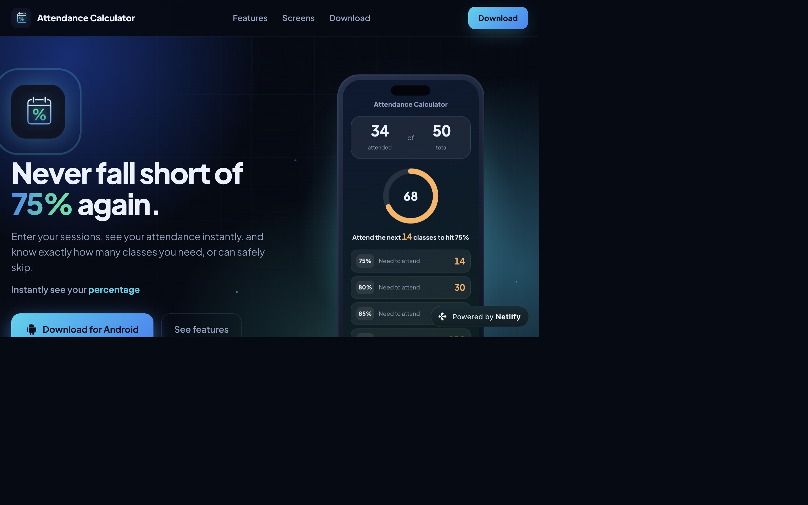
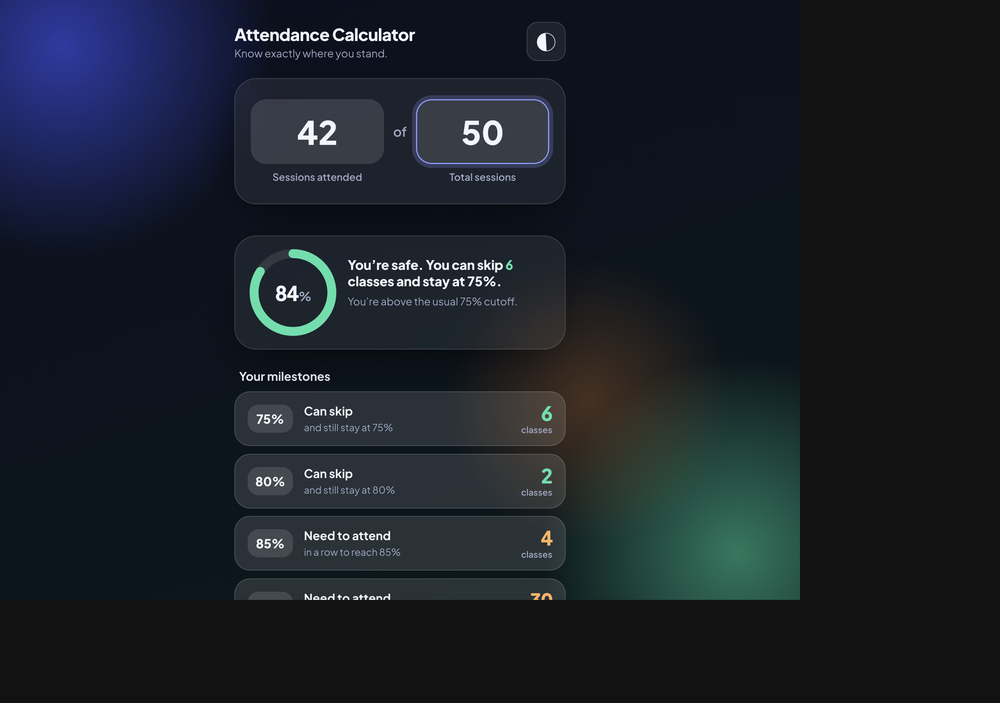

<div align="center">


# 📊 Attendance Calculator

**A fast, clean, and responsive attendance companion for planning classes with confidence.**

[](https://aryan-9907.github.io/Attendance-Calculator/web/index.html)
[](https://attendance-calculator1.netlify.app/)
[](https://github.com/Aryan-9907/Attendance-Calculator/releases)
[](#-built-with)

</div>

---

## 🌐 Live Links

| View | Link |
|---|---|
| 📱 **Main App** | [Open Attendance Calculator](https://aryan-9907.github.io/Attendance-Calculator/web/index.html) |
| 🚀 **Landing Page** | [Visit the Product Website](https://attendance-calculator1.netlify.app/) |
| 📦 **Android APK** | [Download from GitHub Releases](https://github.com/Aryan-9907/Attendance-Calculator/releases) |
| 🧑‍💻 **Source Code** | [View the Repository](https://github.com/Aryan-9907/Attendance-Calculator) |

---

## 📸 Screenshots

### 🖥️ Landing Page

<div align="center">
  
</div>

### 📱 Main App

<div align="center">
  
</div>

> The interface adapts for phones, tablets, and desktop screens with a compact mobile-first layout.

---

## ✨ Features

### 📈 Attendance Insights

- Calculate the current attendance percentage instantly
- See how many classes must be attended consecutively
- Calculate how many classes may be missed while staying above a target
- View clear milestone cards for **75%**, **80%**, **85%**, **90%**, and **95%**
- Use a live animated attendance ring with safety, warning, and danger states

### 🌗 Theme and Personalization

- Switch between light and dark themes
- Automatically remember the selected theme
- Restore saved attended and total-session values after reopening
- Enjoy smooth, responsive theme and result animations

### 📱 Mobile-Friendly Experience

- Optimized for small and large Android screens
- Prevents unwanted horizontal scrolling
- Uses safe-area spacing for modern mobile devices
- Honors reduced-motion device preferences
- Includes touch-friendly controls and accessible keyboard interactions

### 🎨 Creator and Reset Experience

- Tap the app title to open the creator credit card
- Open the project directly through the GitHub button
- Confirm destructive resets through a themed confirmation card
- Close dialogs using the button, backdrop, or Escape key

---

## 🧠 How It Works

Let:

- `A` = classes or sessions attended
- `T` = total classes or sessions held
- `P` = target attendance percentage

| Goal | Formula |
|---|---|
| Current attendance | `A ÷ T × 100` |
| Consecutive classes to attend | `ceil((P × T − 100 × A) ÷ (100 − P))` |
| Classes that may be missed at 75% | `floor((A × 100 ÷ 75) − T)` |
| Attendance milestone calculation | `ceil((M × T − 100 × A) ÷ (100 − M))` |

### Example

If `42` sessions are attended out of `50`:

- Current attendance = **84%**
- Safe classes at **75%** = **6**
- Classes needed for **85%** = **4**
- Classes needed for **90%** = **30**

---

## 🗂️ Project Structure

```text
Attendance-Calculator/
├── web/                         # Main browser and Android app source
│   ├── index.html               # App markup
│   ├── style.css                # Themes, layout, and animations
│   └── script.js                # Calculations and user interactions
├── landing-page/                # Public product landing page
│   ├── index.html
│   ├── style.css
│   ├── script.js
│   └── assets/icon.png
├── android/                     # Capacitor Android project
├── assets/                      # README screenshots
├── index.html                   # GitHub Pages entry redirect
├── package.json                 # Project scripts and dependencies
├── capacitor.config.json        # Capacitor configuration
└── .github/workflows/           # Automated Android APK workflow
```

---

## 🚀 Run Locally

### Option 1: Open the app

Open [web/index.html](web/index.html) directly in a browser.

### Option 2: Use a local server

```bash
cd Attendance-Calculator
npm start
```

Then visit:

```text
http://localhost:4173
```

### 🌐 Landing Page

```bash
python3 -m http.server 4178 --directory landing-page
```

Visit:

```text
http://localhost:4178
```

---

## 📲 Build the Android App

The repository contains a Capacitor Android project.

```bash
npm install
npx cap sync android
cd android
./gradlew assembleDebug
```

The generated APK will be available under:

```text
android/app/build/outputs/apk/debug/app-debug.apk
```

GitHub Actions can also build the APK automatically using [.github/workflows/build-apk.yml](.github/workflows/build-apk.yml).

---

## 🛠️ Built With


- **Vanilla HTML, CSS, and JavaScript** — lightweight and framework-free
- **Capacitor** — packages the web app as an Android application
- **Android Gradle** — builds the APK
- **GitHub Actions** — automates Android builds
- **GitHub Pages** — hosts the live web app
- **Netlify** — hosts the landing page

---

## 🎯 Future Ideas

- [ ] Multiple-subject attendance tracking
- [ ] Import attendance details from screenshots
- [ ] Custom attendance targets
- [ ] Detailed subject and semester summaries
- [ ] Export attendance reports
- [ ] Backup and restore data
- [ ] Improved APK installation prompts

---

## 🤝 Contributing

Contributions, bug reports, and feature suggestions are welcome.

1. Fork the repository
2. Create a feature branch

   ```bash
   git checkout -b feature/your-feature
   ```

3. Commit your changes

   ```bash
   git commit -m "Add your feature"
   ```

4. Push the branch

   ```bash
   git push origin feature/your-feature
   ```

5. Open a pull request

---

## 👤 Author

<div align="center">

**Made with ❤️ by Aryan**

[](https://github.com/Aryan-9907)

⭐ If this project helps you, consider giving the repository a star!

</div>
