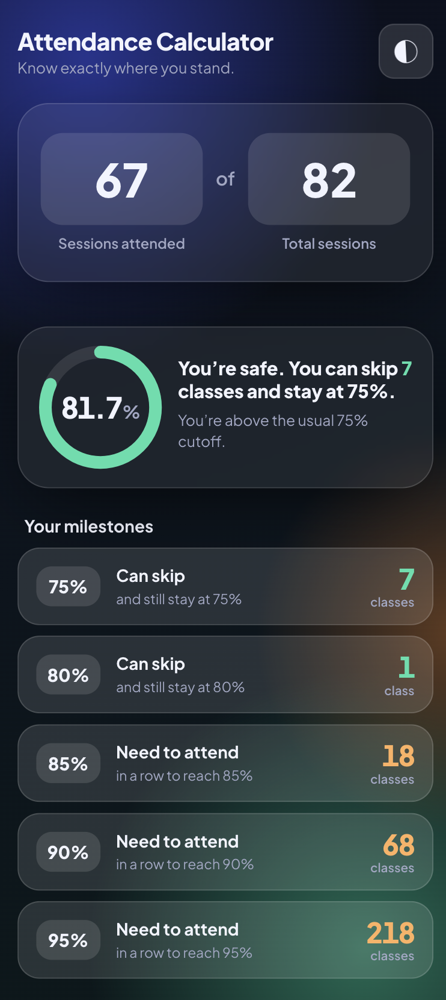
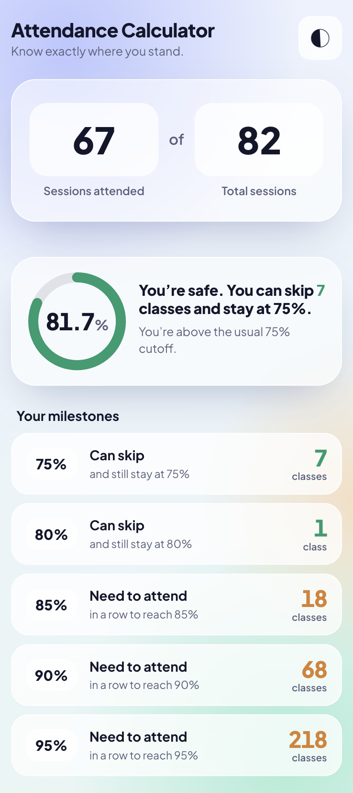
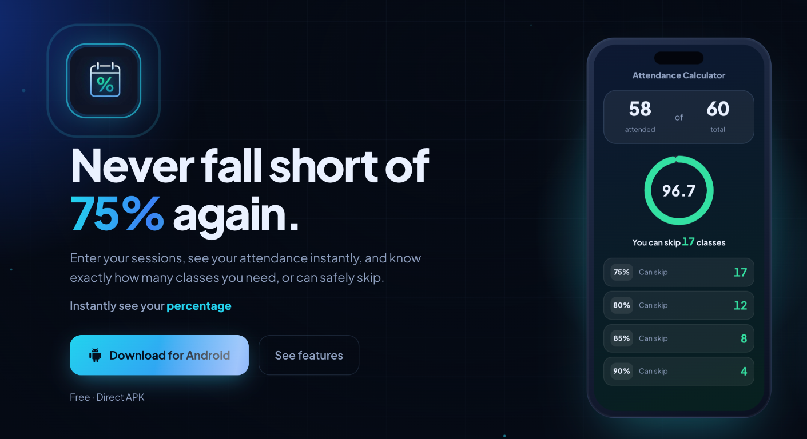

# 📊 Attendance Calculator

**A modern, responsive attendance tracker built with HTML, CSS, JavaScript, and Android (Capacitor).**


---

## About This Project

**Attendance Calculator** is a clean, fast, and mobile-friendly app that helps students understand their current attendance and plan upcoming classes.

It instantly calculates attendance percentage, shows the number of classes needed to reach common targets, and identifies how many classes can be missed while remaining above a selected milestone.

The project includes both a **responsive web app** and an **Android application** built with Capacitor.

---

## ✨ Features

- 📈 Calculates the live attendance percentage
- 🧮 Shows classes needed for 75%, 80%, 85%, 90%, and 95%
- 🏖️ Calculates how many classes may be missed safely
- 🌗 Light and dark theme support
- 💾 Saves attendance values and theme preference locally
- 📱 Fully responsive mobile-first layout
- ⚡ Smooth, lightweight animations
- 🧭 Reset confirmation card
- 🎨 Modern glass-style interface
- ♿ Keyboard support and reduced-motion accessibility
- 📲 Android app build support

---

## 🚀 Live Demo

**🌐 Web App**

https://aryan-9907.github.io/Attendance-Calculator/web/index.html

**🚀 Landing Page**

https://attendance-calculator1.netlify.app/

**📦 Latest Android Release**

https://github.com/Aryan-9907/Attendance-Calculator/releases/latest

---

## 📸 Screenshots

<table width="100%">
  <tr>
    <td width="50%" align="center" valign="top">
      
    </td>
    <td width="50%" align="center" valign="top">
      
    </td>
  </tr>
  <tr>
    <td colspan="2" align="center">
      
    </td>
  </tr>
</table>

---

## 🧠 How It Works

Let:

- `A` = classes attended
- `T` = total classes held
- `P` = target percentage

| Goal | Formula |
|------|---------|
| Current percentage | `A / T × 100` |
| Classes to attend consecutively | `ceil((P × T − 100 × A) / (100 − P))` |
| Classes that may be missed at 75% | `floor(A × 100 / 75 − T)` |

**Example:** Attended 67 of 82 classes gives an attendance percentage of approximately **81.7%**. The app shows that 7 classes may be missed while staying above 75%, and 18 classes must be attended consecutively to reach 85%.

---

## 🛠️ Technologies Used

- HTML5
- CSS3
- JavaScript (ES6)
- Android WebView
- Capacitor
- Android Gradle
- GitHub Actions
- GitHub Pages
- Netlify

---

## 🚀 How to Run

### 1️⃣ Clone the Repository

```bash
git clone https://github.com/Aryan-9907/Attendance-Calculator.git
cd Attendance-Calculator
```

### 2️⃣ Run the Web App

Open `web/index.html` in a browser, or start a local server:

```bash
npm start
```

Then visit:

```text
http://localhost:4173
```

### 3️⃣ Run the Landing Page

```bash
python3 -m http.server 4178 --directory landing-page
```

Then visit:

```text
http://localhost:4178
```

---

## 📲 Build the Android APK

```bash
npm install
npx cap sync android
cd android
./gradlew assembleDebug
```

The APK will be generated at:

```text
android/app/build/outputs/apk/debug/app-debug.apk
```

---

## 📂 Project Structure

```text
Attendance-Calculator/
│
├── web/
│   ├── index.html
│   ├── style.css
│   └── script.js
├── landing-page/
│   ├── index.html
│   ├── style.css
│   ├── script.js
│   └── assets/
├── android/
├── screenshots/
├── index.html
├── package.json
├── capacitor.config.json
└── README.md
```

---

## 🌟 Future Improvements

- 📚 Multi-subject attendance tracking
- 📷 Extract attendance details from screenshots
- 🎯 Custom target percentage
- ☁️ Optional cloud backup
- 📊 Detailed attendance history and reports
- 📤 Export attendance summaries
- 📲 Improved Android release notifications

---

## 🤝 Contributing

Contributions, ideas, and suggestions are welcome.

Feel free to fork the repository and submit a pull request.

---

<div align="center">

### ⭐ If you like this project, consider giving it a Star!

Made with ❤️ by **Aryan**

</div>
